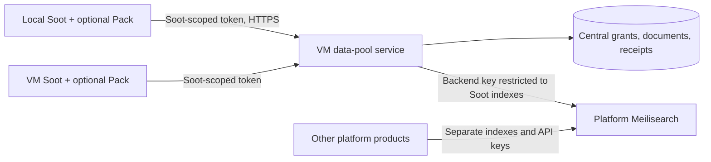

# Install platform Meilisearch separately

The operator chooses Docker, a VM template, a binary, or an existing managed
instance. Soot can explain the setup; installing/selecting the data-pool Pack
never installs, starts or provisions Meilisearch. The tested Community Edition
version is v1.54.3. This is shared platform search infrastructure, independent of
Soot. Other products own their indexes and restricted API keys.

## Local Docker

Install Docker using its normal platform instructions. Prepare a private
`meili.env` file (mode 0600, outside Git) containing a randomly generated
`MEILI_MASTER_KEY` of at least 32 characters, plus:

```dotenv
MEILI_ENV=production
MEILI_NO_ANALYTICS=true
MEILI_MAX_INDEXING_MEMORY=512 MiB
MEILI_MAX_INDEXING_THREADS=1
```

Run these commands yourself from the directory holding that file:

```sh
docker volume create platform-meilisearch
docker run -d --name platform-meilisearch --restart unless-stopped \
  --memory 1g --cpus 1 --env-file ./meili.env \
  -p 127.0.0.1:7700:7700 \
  -v platform-meilisearch:/meili_data \
  getmeili/meilisearch:v1.54.3
curl --fail http://127.0.0.1:7700/health
```

The persistent volume survives container replacement. `/health` is public; it
proves availability, not authentication. Verify `/indexes` fails without a key
and succeeds using a private curl config/header file. Avoid putting keys in
shell history, command arguments or pasted output. Docker operators can inspect
a container's environment; this is an operator-owned local service.

Meilisearch's [Docker guide](https://www.meilisearch.com/docs/resources/self_hosting/getting_started/docker)
and [versioned configuration](https://github.com/meilisearch/meilisearch/blob/v1.54.3/config.toml)
cover persistent data and indexing limits. Choose RAM for the actual index size;
512 MiB limits indexing work, not all process memory. This 1 GiB example is a
starting allocation, not a capacity guarantee.

## VM using 2server

The separate `meilisearch` template in 2server deploys a named stateful App:

```sh
2srv init app platform-search --template meilisearch -o platform/search.yaml
2srv validate -f platform/search.yaml
2srv secret set --app platform-search --env-file /private/meili.env --apply
2srv plan -f platform/search.yaml
2srv deploy -f platform/search.yaml --apply
```

These are operator-run commands on the selected, already connected VM. Use a
2server CLI build/release containing the template; this working-tree change does
not update an installed CLI. The template keeps its master key in private
mounted files, checks authenticated readiness, and publishes no host port. It
has no dependency on Soot and creates no data pools or Soot credentials.
Read the [2server Meilisearch runbook](https://github.com/2found/2server/blob/main/docs/meilisearch.md)
for a separate HTTPS Domain, internal endpoint bindings, backups and upgrades.
Other installation methods remain supported: supply an existing endpoint to
the connector instead of deploying this template.

## One VM pool used from both local and VM



Run one authoritative [data-pool service](shared-service.md) for the company.
Bind local and VM Soots to that service, rather than copying a policy database
to each machine. Meilisearch installation, service administration and installing
the optional Soot connector are separate operator steps. Removing the Pack
leaves the shared search service and data intact.
